<p align="center">
  
</p>
<h1 align="center">codec</h1>
<p align="center">
  <b>The local workbench for a DevOps engineer's day.</b><br>
  Read and check the YAML you live in, make sense of logs, and do the small<br>
  jobs around them, in one binary. Nothing leaves your machine.
</p>
<p align="center">
  <a href="https://github.com/mahasenabheetha/codec/actions/workflows/ci.yml"></a>
  <a href="https://github.com/mahasenabheetha/codec/actions/workflows/codeql.yml"></a>
  <a href="https://scorecard.dev/viewer/?uri=github.com/mahasenabheetha/codec"></a>
  <a href="https://github.com/mahasenabheetha/codec/releases"></a>
  <a href="LICENSE"></a>
  
  <a href="https://mahasenabheetha.github.io/codec/"></a>
</p>
<p align="center">
  <a href="https://mahasenabheetha.github.io/codec/"><b>Documentation</b></a> ·
  <a href="#install">Install</a> ·
  <a href="#features">Features</a> ·
  <a href="#cli">CLI</a> ·
  <a href="https://github.com/mahasenabheetha/codec/releases">Releases</a> ·
  <a href="CHANGELOG.md">Changelog</a>
</p>

<p align="center">
  <picture>
    <source media="(prefers-color-scheme: light)" srcset="docs/images/demo-light.png">
    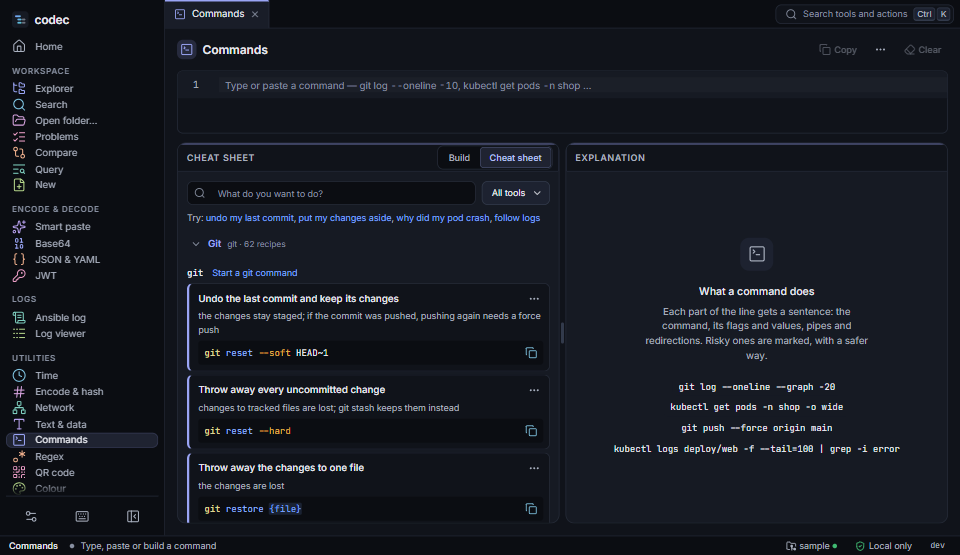
  </picture>
</p>

## Contents

[Why codec](#why-codec) · [Features](#features) · [Install](#install) ·
[CLI](#cli) · [How it works](#how-it-works) ·
[Privacy and security](#privacy-and-security) ·
[Documentation](#documentation) · [Contributing](#contributing)

## Why codec

Most of a platform engineer's day is spent *reading* YAML: what this
chart renders with the prod values, which job runs after which, where an
Ansible variable is really set, what an Argo step receives. The answers
usually need a cluster, a pipeline run or a lot of scrolling. codec
answers them from the files alone.

The rest of the day is small jobs around that YAML: why a pipeline
failed, what a JWT or a base64 Secret value says, when a cron schedule
fires, whether a regex matches. They usually send you to a website, with
your tokens and passwords. codec does them locally, next to the files
they belong to.

| | |
|---|---|
| **Understand, don't just edit** | Each file is shown the way the tool that runs it sees it: Helm's merged values, GitLab's effective job after `extends`, Compose's merged services, Ansible's execution order. |
| **Try things safely** | Edits are *what-if*: they change what you see, never the file. Copy the result, or a patch `git apply` accepts. |
| **Every problem explained** | Each finding says why it matters and how to fix it, on the exact line. |
| **One place for the small jobs** | Logs, encodings, hashes, secrets, timestamps, cron and regex, in the same app and the same CLI. |
| **Private by design** | Never writes to your files, stores nothing you paste, has no telemetry and listens on `127.0.0.1` only. Works offline. |

## Features

| Area | What codec does | Guide |
|---|---|---|
| **Helm** | Renders charts exactly like `helm template` with the embedded Helm 4 SDK; layers values files, saves profiles, shows which file set every value | [Helm](https://mahasenabheetha.github.io/codec/helm.html) |
| **Kubernetes, Kustomize** | Objects as cards, a relationship graph, an inventory, broken references; Kustomize built in-process | [Kubernetes](https://mahasenabheetha.github.io/codec/kubernetes.html) |
| **Argo** | Workflows as graphs, each step's template and inputs resolved across files; Argo CD apps rendered with their values | [Argo](https://mahasenabheetha.github.io/codec/argo.html) |
| **CI pipelines** | GitHub Actions, GitLab CI and Azure Pipelines in execution order, with each job's effective configuration and the origin of every line | [CI](https://mahasenabheetha.github.io/codec/ci.html) |
| **Compose, Ansible** | Compose merged like `docker compose config`; playbooks in the order Ansible runs them, variables ranked by precedence | [Compose](https://mahasenabheetha.github.io/codec/compose.html) · [Ansible](https://mahasenabheetha.github.io/codec/ansible.html) |
| **Lint and schemas** | YAML 1.1 traps, risky Kubernetes settings, removed APIs, and schema validation for Kubernetes, CRDs and CI files, in the editor, across the repo and in CI | [Lint](https://mahasenabheetha.github.io/codec/lint.html) |
| **Compare, query, search** | Diff by meaning, jq over the whole repo, Find in Files | [Compare](https://mahasenabheetha.github.io/codec/compare.html) |
| **Log viewer** | Structured, pipeline, build and platform logs filtered, charted, grouped by error and traced to the code that wrote them | [Logs](https://mahasenabheetha.github.io/codec/logs.html) |
| **Commands** | A command line explained part by part and built with a form; risky parts flagged with a safer way | [Commands](https://mahasenabheetha.github.io/codec/tools.html#commands) |
| **Everyday tools** | Sanitize, Quote, Smart paste, JSON & YAML, Base64, JWT, hashes, UUIDs, CIDR, time zones, cron, regex, QR codes, colours | [Tools](https://mahasenabheetha.github.io/codec/tools.html) |
| **Focus and breaks** | A focus timer and break reminders with calm sounds | [Wellness](https://mahasenabheetha.github.io/codec/wellness.html) |

Open a section for screenshots and the details.

<details open>
<summary><b>YAML workbench</b>: Helm, Kubernetes and Kustomize, Argo, CI pipelines, Compose and Ansible; lint, schemas, compare, query and starters</summary>
<br>

<table>
<tr>
<td width="50%"><b>Helm</b><br>Render charts exactly like <code>helm template</code> with the embedded Helm 4 SDK: no helm install, no cluster. Layer values files, save profiles, and see which file set every value.<br><a href="https://mahasenabheetha.github.io/codec/helm.html">Helm guide →</a></td>
<td width="50%">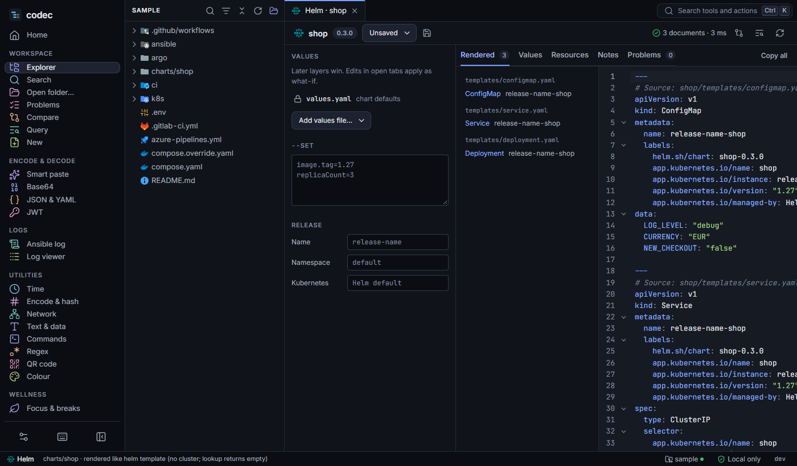</td>
</tr>
<tr>
<td>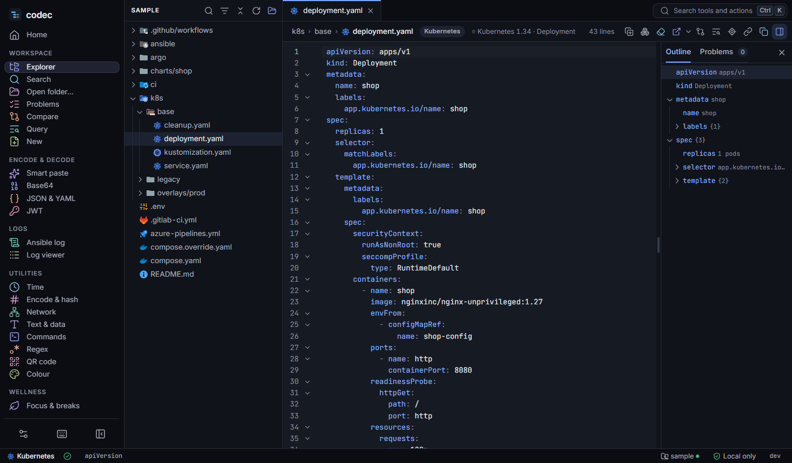</td>
<td><b>Workspace and editor</b><br>Open a repo read-only; every YAML file is labelled by type, and the explorer shows which files have what-if edits and problems. An editor that understands Helm, Jinja, GitHub and Argo expressions, with plain-English errors, hover, go to definition, schema completion and snippets. Markdown rendered as on GitHub, safely.<br><a href="https://mahasenabheetha.github.io/codec/workspace.html">Workspace guide →</a></td>
</tr>
<tr>
<td><b>Lint and schemas</b><br>YAML 1.1 traps, risky Kubernetes settings, removed APIs for your target version, and schema validation for Kubernetes, CRDs, GitHub Actions, GitLab CI, Azure Pipelines and Compose: in the editor, across the repo and in CI.<br><a href="https://mahasenabheetha.github.io/codec/lint.html">Lint guide →</a></td>
<td>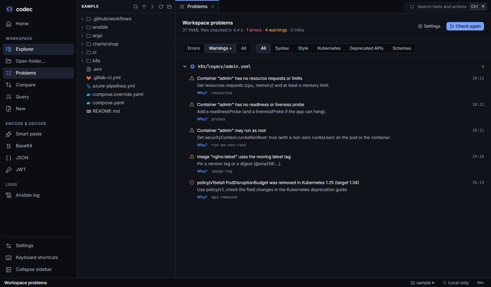</td>
</tr>
<tr>
<td>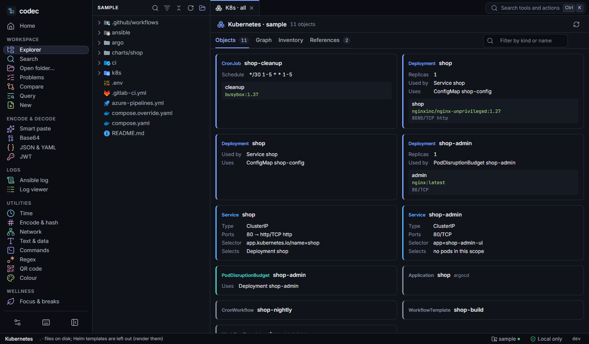</td>
<td><b>Kubernetes and Kustomize</b><br>Manifests, renders and builds as cards, a relationship graph, an inventory and broken references. Kustomize builds in-process, identical to <code>kubectl kustomize</code>.<br><a href="https://mahasenabheetha.github.io/codec/kubernetes.html">Kubernetes guide →</a></td>
</tr>
<tr>
<td><b>Argo</b><br>Workflows as graphs, every step's template and inputs resolved across files; <code>when</code> and <code>depends</code> evaluated; run-time values marked, never guessed. Argo CD apps rendered with their values.<br><a href="https://mahasenabheetha.github.io/codec/argo.html">Argo guide →</a></td>
<td>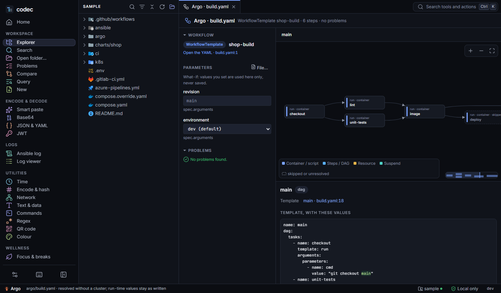</td>
</tr>
<tr>
<td>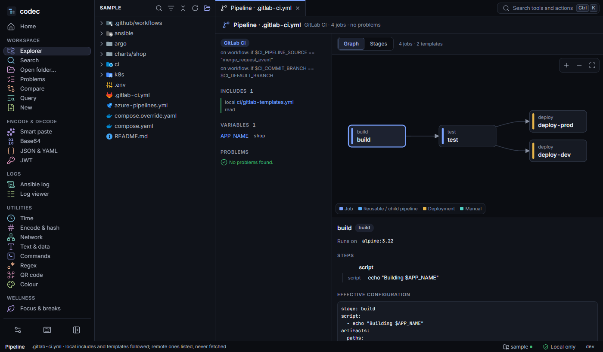</td>
<td><b>CI pipelines</b><br>GitHub Actions, GitLab CI and Azure Pipelines in execution order, stages as named lanes, every matrix combination, and each job's effective configuration with the origin of every line.<br><a href="https://mahasenabheetha.github.io/codec/ci.html">CI guide →</a></td>
</tr>
<tr>
<td><b>Compose and Ansible</b><br>Compose files merged like <code>docker compose config</code>, variables from <code>.env</code>, services as a graph. Playbooks in the order Ansible runs them, roles in place, variables ranked by precedence, and a playbook map coloured by a run from a log.<br><a href="https://mahasenabheetha.github.io/codec/compose.html">Compose</a> · <a href="https://mahasenabheetha.github.io/codec/ansible.html">Ansible</a></td>
<td>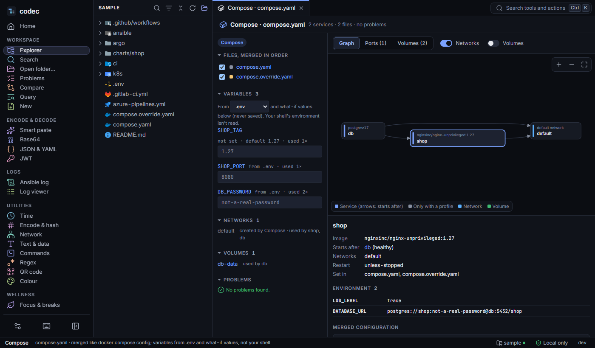</td>
</tr>
<tr>
<td>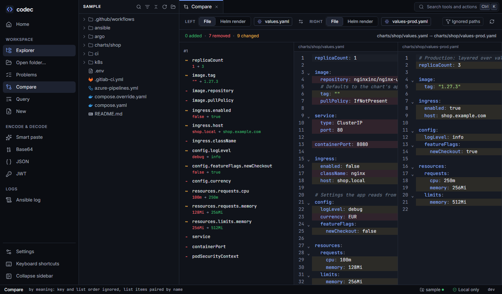</td>
<td><b>Compare, query and search</b><br>Diff by meaning (key and list order ignored, containers paired by name), including dev vs prod renders, or pasted text such as a live object. Run jq over the whole repo, or Find in Files for plain text, and jump to each result.<br><a href="https://mahasenabheetha.github.io/codec/compare.html">Compare guide →</a></td>
</tr>
<tr>
<td><b>New files and clones</b><br>Starters with a short form, linted and rendered before you copy them; your own team starters; clone a file under a new name with references renamed and everything else listed.<br><a href="https://mahasenabheetha.github.io/codec/new.html">Starters guide →</a></td>
<td>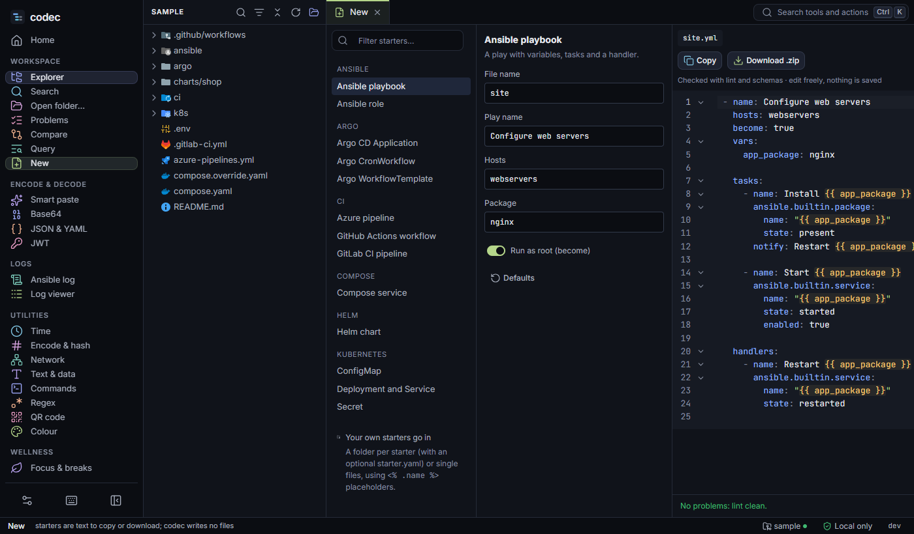</td>
</tr>
</table>

</details>

<details>
<summary><b>Log viewer</b>: structured, pipeline, build and platform logs filtered, charted and traced to the code</summary>
<br>

<picture><source media="(prefers-color-scheme: light)" srcset="docs/images/logs-light.png">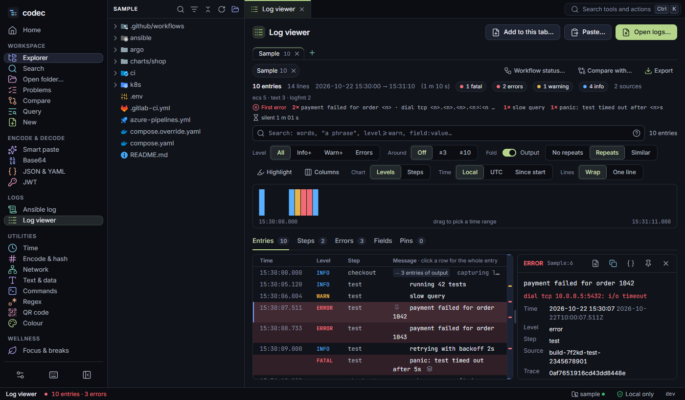</picture>

- **Any common format**: ECS and other JSON, logfmt, klog and text with
  stack traces, as `argo logs` or `kubectl logs` print them.
- **Pipelines and builds read into steps**: Azure DevOps, GitHub
  Actions, GitLab, Jenkins; BuildKit, Terraform, Maven, Gradle, npm,
  dotnet, go test, pytest; access logs, syslog and Kubernetes events.
- **Find what matters**: filter as you type with a small query language,
  see the errors that repeat, fold repeated lines, pin entries, compare
  two runs, merge several files by time.
- **A chart that keeps the whole log in view**: drag a time range and it
  is drawn as a window over the rest; a warning or an error is never
  lost under a tall bar of info.
- **From a line to the code**: a file and line in a log opens a
  read-only peek of the source in the open folder.
- **Argo runs step by step**, beside their status from `argo get`, and
  a log can be followed as it grows.

[Log viewer guide →](https://mahasenabheetha.github.io/codec/logs.html)

</details>

<details>
<summary><b>Commands</b>: command lines explained and built, risky parts flagged, a cheat sheet by purpose</summary>
<br>

<picture><source media="(prefers-color-scheme: light)" srcset="docs/images/commands-light.png">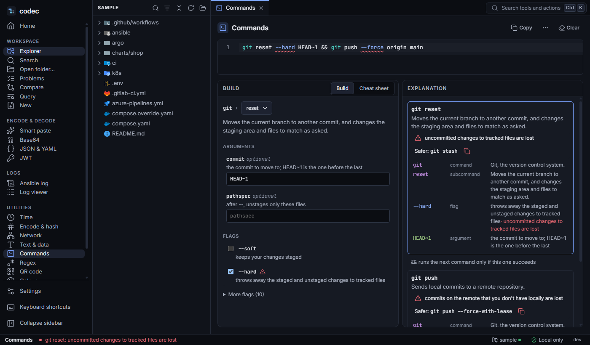</picture>

- **Explain and build**, each following the other, for git, kubectl,
  helm, docker and compose and some 37 Linux tools.
- **Risky parts are marked** with what they can break and a safer way
  (`git push --force-with-lease`).
- **A cheat sheet by purpose**: find a command by what you want to do
  (*undo my last commit*).
- Copy for bash or PowerShell; `codec explain` and `codec how` on the
  command line.

[Commands guide →](https://mahasenabheetha.github.io/codec/tools.html#commands)

</details>

<details>
<summary><b>Everyday tools</b>: Sanitize, Quote, Smart paste, JSON & YAML, encodings, time, network, generators</summary>
<br>

<picture><source media="(prefers-color-scheme: light)" srcset="docs/images/sanitize-light.png">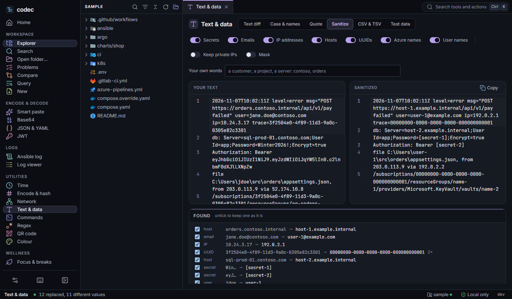</picture>

| Group | Tools |
|---|---|
| **Share safely** | **Sanitize** replaces secrets, emails, IP addresses, host names, UUIDs, Azure names and user names with stand-ins, the same one throughout, so the text still reads. **Quote** writes a value so bash, PowerShell, cmd, JSON, YAML, `.env`, Helm or a Dockerfile reads it back exactly. |
| **Read** | Smart paste, Base64, JWT claims, Ansible logs (the failure, its probable cause, where the task is defined), and JSON & YAML: format (JSONC and JSON5 too), a tree with paths, conversion, a diff by path, an inferred JSON Schema and jq. |
| **Encode and generate** | URL and hex, hashes and HMAC, file checksums, random secrets, passwords and passphrases with their strength, UUIDs (v4, v7, v5, v3), htpasswd lines, test data as JSON, CSV, YAML or SQL, QR codes made and read, colours with WCAG contrast. |
| **Network** | CIDR ranges (subnets, overlaps), IP addresses, a URL builder, curl ⇄ fetch, HTTP status codes. |
| **Text and tables** | A text diff, a name in every case checked against Kubernetes, Helm and env-var rules, CSV or TSV as a table to sort, filter and convert. |
| **Time** | Timestamps, time zones with a working-hours overlap, date formats, cron schedules in plain words with their next runs, a regex tester that explains the pattern. |

Tools with tabs (Smart paste, Base64, Compare, JSON & YAML, the Ansible
log, the Log viewer) keep several inputs open at once. **Send to** hands
one tool's output to another, a copy button sits beside every value, and
a clear can be undone. Nothing pasted or generated is stored.

[Tools guide →](https://mahasenabheetha.github.io/codec/tools.html)

</details>

<details>
<summary><b>Focus and breaks</b>: a focus timer, break reminders, sounds</summary>
<br>

<picture><source media="(prefers-color-scheme: light)" srcset="docs/images/wellness-light.png">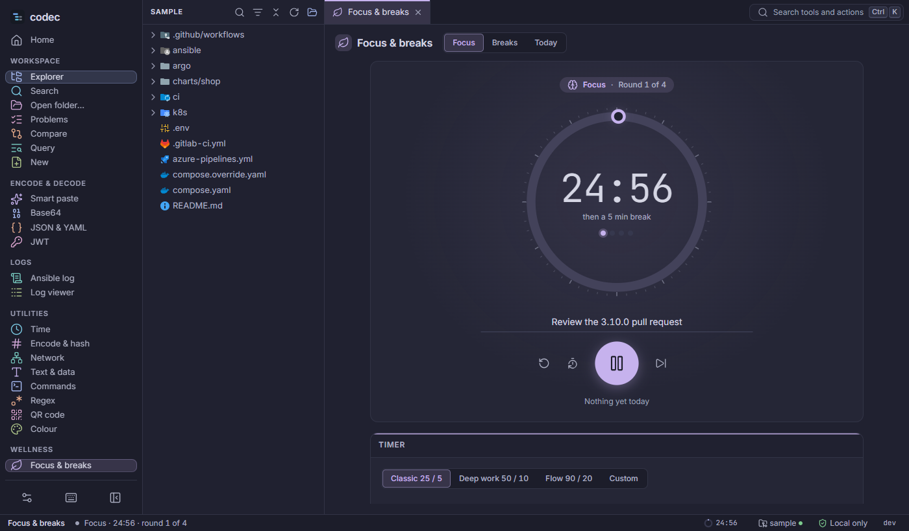</picture>

A focus timer on a large ring (Classic 25/5, Deep work 50/10, Flow 90/20
or your own lengths), today's sessions on a timeline, and break
reminders for your eyes (20-20-20), stretches, water and posture, shown
as a full-window break with guided breathing, a card or a toast. Fourteen
calm chimes, focus sounds (noise, rain, ocean) and an optional system
notification. It runs in any tool, from the status bar, the palette or
the desktop tray.

[Focus and breaks guide →](https://mahasenabheetha.github.io/codec/wellness.html)

</details>

### Built for a whole working day

- **A layout that is yours.** Every divider drags (or moves with the
  arrow keys), any tool can put its input over its output, and sizes are
  remembered. Pin the tools you use to the top of the rail and of Home.
- **Keyboard first.** <kbd>Ctrl</kbd> <kbd>K</kbd> finds every action,
  setting and view; graphs, trees, tabs and dividers all work without a
  mouse. [Shortcuts](https://mahasenabheetha.github.io/codec/shortcuts.html).
- **Forgiving.** Clearing a tool, unpinning, deleting a profile or
  turning a rule off offers **Undo**; a view that fails to refresh keeps
  what it showed and offers **Try again**.
- **Ten themes, three sizes.** Dark and Light; Dusk, Midnight, Forest,
  Rosé and Ocean, soft dark themes for long days; warm Paper, dimmed
  Mist and High contrast. Each tool has its own colour, checked for
  contrast in every theme, and the colours can be switched off.
- **Accessible.** Visible focus, status never shown by colour alone,
  reduced motion honoured, labels and announcements for screen readers.
  [Design language](https://mahasenabheetha.github.io/codec/design.html).

## Install

| How | For | Get it |
|---|---|---|
| **CLI and web UI** | Windows, macOS, Linux (amd64, arm64). One binary, no installer, no admin rights | [Releases](https://github.com/mahasenabheetha/codec/releases): `codec_<version>_<os>_<arch>` |
| **Desktop app** | Windows. Its own window, a tray icon, *Open with* for YAML files; installs for you alone | [Releases](https://github.com/mahasenabheetha/codec/releases): `codec-desktop_<version>_windows_amd64_setup.exe`, or the portable `.exe` |
| **Docker** | Anywhere. Distroless, non-root, linux/amd64 and linux/arm64 | `ghcr.io/mahasenabheetha/codec` |
| **From source** | Go 1.26+ and Node.js 22+ | See [below](#from-source) |

### Quick start

Unpack the archive and run:

```bash
codec serve --open --sample
```

Your browser opens codec on a small made-up repository with one of
everything, landing on its rendered Helm chart. Then open your own:

```bash
codec serve --open --root path/to/your/repo
```

On Windows, SmartScreen may warn about the unsigned binary (*More info →
Run anyway*); on macOS run `xattr -d com.apple.quarantine codec` once.
[Getting started](https://mahasenabheetha.github.io/codec/getting-started.html)
has the details for every platform.

### Desktop app (Windows)

The installer needs no admin rights, adds a Start menu entry and offers
codec in Explorer's *Open with* for YAML files. Closing the window keeps
codec in the tray; *Settings → Desktop* turns on Start at login. macOS
follows later.

### Docker

```bash
docker run --rm -p 127.0.0.1:8765:8765 -v "$PWD:/work:ro" ghcr.io/mahasenabheetha/codec
```

Open http://localhost:8765. The repository is mounted read-only; add
`-v codec-home:/home/nonroot` to keep settings between runs.

### From source

```bash
git clone https://github.com/mahasenabheetha/codec.git && cd codec
npm --prefix frontend ci && npm --prefix frontend run build
go build -o codec ./cmd/codec
```

### Updates

codec can tell you when a newer release is out: switch on *Check for
updates* in Settings (off by default), or run `codec version --check`.

## CLI

The UI and the CLI share one engine, so everything works in a terminal
and in CI. Exit code 2 means findings.

```bash
codec yaml lint deploy/ charts/ --k8s-version 1.31      # lint + schemas, a CI gate
codec helm values ./charts/shop -f values-prod.yaml --provenance
codec kustomize build overlays/prod                     # no kubectl needed
codec ci job .gitlab-ci.yml deploy-prod                 # effective config, origin per line
codec argo resolve argo/ -p environment=prod            # every step and its inputs
codec yaml diff dev.yaml prod.yaml                      # by meaning
codec yaml query '.spec.template.spec.containers[].image' .
codec search -w replicas charts/                        # text in every listed file
codec cron '*/15 2-6 * * 1-5' --zone Europe/Stockholm  # plain words, next runs
codec regex --explain '^v(\d+)\.(\d+)$'                 # a pattern part by part
```

All commands: [CLI reference](https://mahasenabheetha.github.io/codec/cli.html).

## How it works

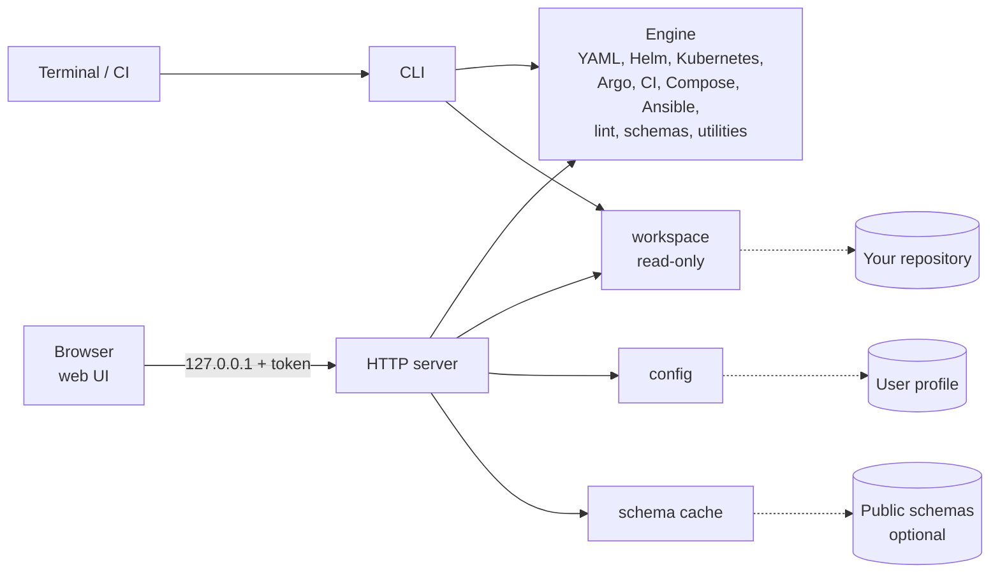

A single Go binary embeds the Svelte UI. The engine is pure: it only
reasons about text it is given, and adapters do all input and output, so
the UI and the CLI always agree. More in
[Architecture](https://mahasenabheetha.github.io/codec/architecture.html)
and [Flows](https://mahasenabheetha.github.io/codec/flows.html).

## Privacy and security

- **Read-only.** codec never writes to the folders it opens. Settings
  live in your user profile.
- **Local.** The server listens on `127.0.0.1` with a per-run token. The
  only network use is downloading public JSON schemas and the optional
  update check; both can be off.
- **Nothing kept.** What you paste into a tool, what-if edits and
  generated secrets are never stored.
- **No telemetry.**

Details: [Security and privacy](https://mahasenabheetha.github.io/codec/security.html).
To report a vulnerability privately, see [SECURITY.md](SECURITY.md).

## Documentation

| | |
|---|---|
| **Start** | [Overview](https://mahasenabheetha.github.io/codec/) · [Getting started](https://mahasenabheetha.github.io/codec/getting-started.html) |
| **Guides** | [Workspace and editor](https://mahasenabheetha.github.io/codec/workspace.html) · [Helm](https://mahasenabheetha.github.io/codec/helm.html) · [Lint and schemas](https://mahasenabheetha.github.io/codec/lint.html) · [Kubernetes and Kustomize](https://mahasenabheetha.github.io/codec/kubernetes.html) · [Argo](https://mahasenabheetha.github.io/codec/argo.html) · [CI pipelines](https://mahasenabheetha.github.io/codec/ci.html) · [Compose](https://mahasenabheetha.github.io/codec/compose.html) · [Ansible](https://mahasenabheetha.github.io/codec/ansible.html) · [Log viewer](https://mahasenabheetha.github.io/codec/logs.html) · [Compare and query](https://mahasenabheetha.github.io/codec/compare.html) · [New files and clones](https://mahasenabheetha.github.io/codec/new.html) · [Tools](https://mahasenabheetha.github.io/codec/tools.html) · [Focus and breaks](https://mahasenabheetha.github.io/codec/wellness.html) |
| **Reference** | [CLI](https://mahasenabheetha.github.io/codec/cli.html) · [Keyboard shortcuts](https://mahasenabheetha.github.io/codec/shortcuts.html) · [Settings and your data](https://mahasenabheetha.github.io/codec/settings.html) · [Troubleshooting](https://mahasenabheetha.github.io/codec/troubleshooting.html) |
| **Project** | [Architecture](https://mahasenabheetha.github.io/codec/architecture.html) · [Flows](https://mahasenabheetha.github.io/codec/flows.html) · [Security and privacy](https://mahasenabheetha.github.io/codec/security.html) · [Design language](https://mahasenabheetha.github.io/codec/design.html) · [Development](https://mahasenabheetha.github.io/codec/development.html) |

The site's source is in [`docs/`](docs/) (plain HTML, also readable offline).

## Contributing

Issues and pull requests are welcome: see [CONTRIBUTING.md](CONTRIBUTING.md).
Contributors and AI agents start at [AGENTS.md](AGENTS.md); how the
project is built and changed is in [design/](design/README.md).
Changes are listed in [CHANGELOG.md](CHANGELOG.md).

## License

[MIT](LICENSE) © Mahasen Abheetha

## Acknowledgements

This project was developed as a hands-on Go learning journey by
[Mahasen Abheetha](https://github.com/mahasenabheetha), with development
assistance from **Claude (Anthropic)** used as a pair-programming and
teaching tool. Design decisions, code review, and explanations were
AI-assisted; the learning was not.

Passphrases use the [EFF large word list](https://www.eff.org/deeplinks/2016/07/new-wordlists-random-passphrases)
by the Electronic Frontier Foundation, licensed under
[CC BY 3.0 US](https://creativecommons.org/licenses/by/3.0/us/); it is
embedded unchanged (`internal/encode/words`).

File and folder icons are from the
[Material Icon Theme](https://github.com/material-extensions/vscode-material-icon-theme)
by Material Extensions, licensed under the MIT licence; the SVGs are
bundled unchanged (`frontend/public/file-icons`, with its `LICENSE.txt`).
